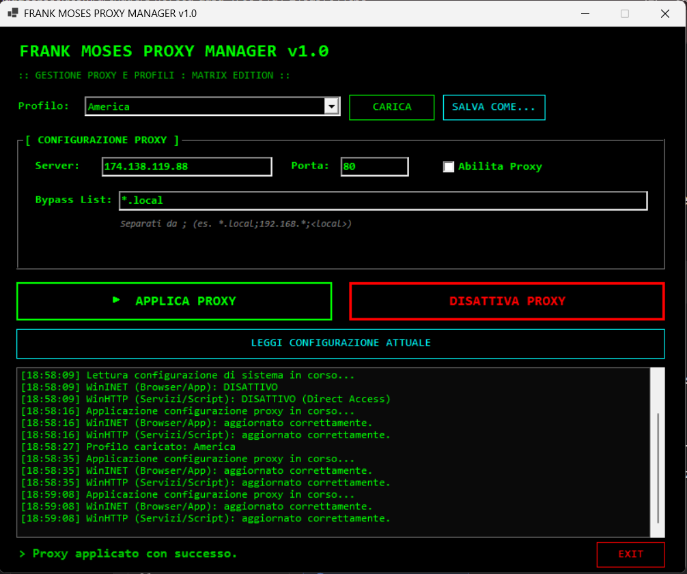

# 🕶️ Proxy Manager

> **Codename: Frank Moses** — *"Il controllo della rete, senza compromessi."*

Gestore avanzato della configurazione Proxy di Windows con GUI Matrix. 
Modifica simultaneamente i livelli **WinINET** (browser e app) e **WinHTTP** (servizi di sistema e PowerShell), con supporto per profili salvabili e bypass list personalizzate.



## ✨ Feature

- ✅ **Interfaccia Matrix**: sfondo nero, testo verde, font Consolas.
- ✅ **Doppio Livello**: gestisce sia WinINET (registro di Windows) che WinHTTP (`netsh`).
- ✅ **Profili Salvabili**: salva indirizzi e bypass list in un file `proxies.xml` per cambiare rete con un click.
- ✅ **Bypass List personalizzata**: per ogni profilo, puoi definire eccezioni specifiche (es. `*.local;192.168.*;<local>`).
- ✅ **Lettura Configurazione**: legge lo stato attuale del proxy da entrambi i livelli e lo mostra nella GUI.
- ✅ **Applicazione Sicura**: gestisce correttamente i permessi di amministratore (necessari per WinHTTP).
- ✅ **Log a schermo e su file**: per tenere traccia di ogni modifica.

## 📋 Requisiti

- **Windows 10 / 11**
- **PowerShell 7.2+** (scarica da https://aka.ms/powershell)
- **Privilegi di amministratore** (necessari per modificare WinHTTP)

## 🚀 Quick start

1. Clona il repo o scarica lo ZIP.
2. Fai doppio click su `avvia.bat` (che richiederà i privilegi di amministratore).
3. Seleziona un profilo dalla lista o inserisci manualmente i dati del proxy.
4. Clicca **APPLICA PROXY**.

## 🧠 Come funziona il file `proxies.xml`

Il tool usa un file `proxies.xml` per salvare i profili. Ogni profilo contiene:
- `Nome`: il nome del profilo (es. "Ufficio", "Casa").
- `Server`: l'indirizzo IP o hostname del proxy.
- `Porta`: la porta del proxy.
- `BypassList`: le eccezioni separate da punto e virgola.

Esempio:
```xml
<?xml version="1.0" encoding="UTF-8"?>
<Proxies>
    <Proxy>
        <Nome>Ufficio</Nome>
        <Server>10.0.0.50</Server>
        <Porta>8080</Porta>
        <BypassList>*.local;192.168.*;10.*;&lt;local&gt;</BypassList>
    </Proxy>
</Proxies>

🎯 Casi d'uso
Cambiare rapidamente configurazione proxy tra casa, ufficio e VPN.

Applicare una bypass list specifica per ogni rete (es. escludere solo gli indirizzi locali in ufficio).

Assicurarsi che sia i browser che i servizi di sistema (PowerShell, Git) usino lo stesso proxy.

Disattivare il proxy in un colpo solo quando non serve.

⚠️ Attenzione
La modifica di WinHTTP richiede privilegi di amministratore. Se il tool non viene eseguito come admin, WinHTTP non verrà aggiornato.

La configurazione del proxy viene applicata immediatamente. Se stai usando una connessione remota (RDP), verifica di non perdere la connessione.

Il tool non gestisce l'autenticazione del proxy (username/password). Se il tuo proxy richiede credenziali, dovrai inserirle manualmente nel browser o nelle impostazioni di sistema.

📝 Changelog
[1.0.0] - 2026-11-09
Aggiunto
GUI Matrix per la gestione del proxy.

Supporto per WinINET (registro) e WinHTTP (netsh).

Profili salvabili in proxies.xml.

Bypass List personalizzata per ogni profilo.

Lettura della configurazione attuale del sistema.

Auto-elevazione admin (necessaria per WinHTTP).

Log a schermo e su file.

📜 Licenza
MIT (vedi LICENSE).

🙏 Crediti
Sviluppato con PowerShell 7 + WinForms.

Fabry Toolbox.
